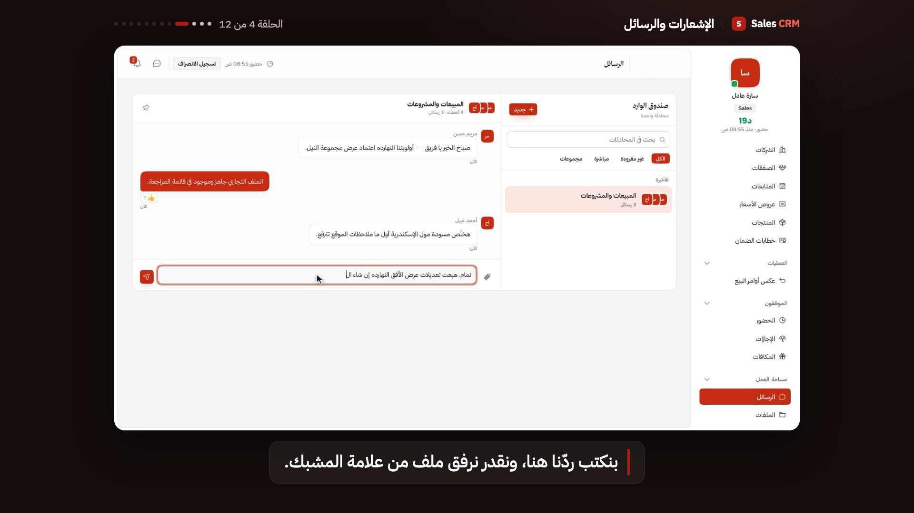
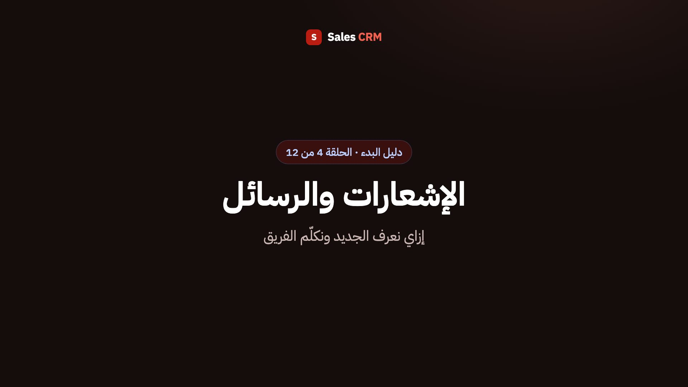
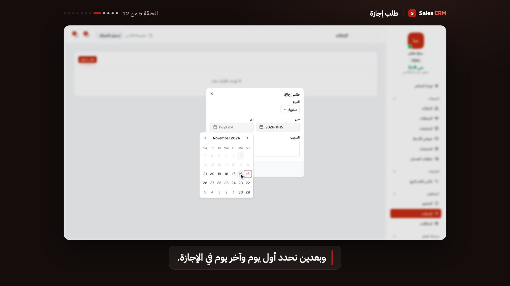

# product-video-series

A [Claude Code](https://claude.com/claude-code) skill for producing a narrated
video series that introduces a web app to new users — onboarding, "getting
started" and training videos — recorded from the **real running app** and
composed with [Remotion](https://www.remotion.dev).



- **Real screens**: Playwright drives the app with a drawn, gliding cursor and
  human-speed typing; no mockups.
- **Narration in any language or dialect**: captions plus
  [ElevenLabs](https://elevenlabs.io) voice-over, with each step holding exactly
  as long as its line, so voice and screen stay in sync by construction.
  Presets for English and three Arabic registers: Modern Standard, Egyptian
  and Gulf.
- **Repeatable demos**: seeded data cloned per run, and a shifted clock (app
  servers, Postgres and browser) so every re-recording shows the same plausible
  weekday morning.
- **Polished frame**: branded intro with a spoken title, spotlight and gentle
  camera on what's being explained, captions, an outro announcing the next
  episode; 1920×1080 H.264 output.
- **Videos that don't go stale**: `npm run check` replays every episode fast
  against the app and fails when a step's element is gone or a label the
  narration quotes is no longer on screen. `check -- labels` does the label
  check against your i18n files in seconds, so it can run on every PR.
- **The method, not just code**: how to plan a series for newcomers, write
  scripts for the ear (including Arabic vowel-mark pitfalls in TTS), pick a
  voice, and QA before rendering.

## Example: a 12-episode Arabic onboarding series

The frames on this page come from a real run on a bilingual (Arabic-first, RTL)
sales CRM, made for every new employee. The client's name and logo are
replaced or masked, and all data shown is the video-only demo seed.

| | |
|---|---|
| Audience | all new employees; the four sales episodes only for sales roles |
| Narration | Egyptian Arabic, `eleven_v4`, a library voice picked from eight previews |
| Output | 12 episodes, 12.6 minutes in all (45 s to 1 min 38 s each), 1920×1080 |
| Voice-over | 85 script lines and 12 spoken titles, 5,366 characters of TTS |
| Persona | one sales rep through one Monday, from first sign-in to check-out |

**The series** follows the order a newcomer meets things: first sign-in and
the welcome tour → check-in → the dashboard → notifications and team chat →
requesting time off → company files → profile and bonuses → companies and
deals → follow-ups → a new quotation → fixing a quotation the manager sent back
→ check-out. Each episode picks up the state the previous one left: the
check-in from episode 2 is the one checked out of in episode 12.

**The demo stack** runs the app's own production build against a private
Postgres cluster. A template database is migrated, dev-seeded and topped up
with an Arabic video-only seed (people, clients, deals, chat, a returned
quotation, company files, a bonus), then cloned fresh for every full run. The
clock is pinned to Monday 2 November 2026 in Riyadh for the app servers, the
database and the browser, so each re-recording shows the same working day.

**A script** is a list of spoken lines; `run()` performs them, and each step
holds exactly as long as its line:

```js
script: [
  "لما نفتح النظام الصبح، كارت الحساب بيقول إننا لسه ما سجّلناش حضور.",
  "عشان نسجّل حضورنا، بندوس على «تسجيل الحضور» اللي فوق.",
  // A `say` variant fixes the voice without changing the caption:
  { text: "ومن صفحة «الحضور» نشوف سجلّ أيامنا…", say: "ومن صفحة «الحضور» نشوف سِجِلّ أيامنا…" },
],
async run(d, page) {
  const line = d.lines(this.script);
  await d.point(accountCard(page), line());
  await d.point(checkIn, line());
  await d.click(checkIn);
  // …
},
```

<p>
  
  
</p>

**Shipping it**: the MP4s went to a Google Drive folder shared by link, and
the app got a training page that plays them through Drive's embedded player,
with the sales episodes gated on the same permission as the Deals screen.

**What the recording found**: walking every screen as a newcomer surfaced five
product issues the team hadn't noticed. The welcome tour described a menu that
had become a link; a role badge was left untranslated; Arabic names got their
avatar initials from the first word only; the date picker spoke English inside
the Arabic UI; and a live timer rendered its Arabic and Latin parts out of
order.

## Install

Clone into your user skills folder; Claude Code then offers it in every project:

```bash
git clone https://github.com/AmrTamer23/product-video-series ~/.claude/skills/product-video-series
```

Update later with `git -C ~/.claude/skills/product-video-series pull`.

## Use

In any project, ask Claude Code for it in plain words, such as "make a series
of short videos showing new staff how to use the system, narrated in Egyptian
Arabic". Before it builds anything, Claude asks you four things: who the videos
are for, the language and dialect (for Arabic: MSA, Egyptian or Gulf), the
ElevenLabs model, and the voice. Nothing gets voiced until you've answered.

Or scaffold directly:

```bash
node ~/.claude/skills/product-video-series/scripts/init.mjs docs/videos \
  --brand "Acme" --base-url http://localhost:3000 --lang ar --strings ar-egyptian \
  --model eleven_v4
cd docs/videos && npm install && npx playwright install chromium ffmpeg
```

| Flag | Values |
|---|---|
| `--lang` | `en` (default) or `ar` |
| `--strings` | frame-text preset: `en`, `ar-msa`, `ar-egyptian`, `ar-gulf` (add your own in `engine/strings.mjs`) |
| `--model` | ElevenLabs model id; default `eleven_v4`, with `eleven_multilingual_v2` as the proven fallback |
| `--locale`, `--name` | date/number locale (`ar-SA`, `en-US` …) and the series name |

Then fill in three files and run:

| File | What goes in it |
|---|---|
| `stack.mjs` | how to reach the app, sign in, and (optionally) reset its data and start it on a shifted clock |
| `episodes.mjs` | the series: per episode a narration script and the actions that perform it |
| `series.config.mjs` | language, frame text, brand colours and logo, demo day, voice |

```bash
npm run voice -- models                  # the account's TTS models for your language (* = current)
npm run voice -- preview egyptian male   # audition library voices on your hardest lines
npm run record                           # voice and record every episode (or: record -- <id>)
npm run studio                           # check in Remotion Studio
npm run render                           # out/<episode>.mp4
npm run check                            # later: do the videos still match the app?
npm run check -- labels                  # no browser: quoted labels vs your i18n files (CI-friendly)
```

The ElevenLabs key goes in `.env` next to `package.json`
(`ELEVENLABS_API_KEY=…`, gitignored). Without a voice configured, the series
records silent with captions.

Every voiced line is cached, keyed by voice, model, settings and text, so
editing one line re-voices only that line. Changing the model or voice
re-voices the whole series. To compare models cheaply, record a single episode
on each: `record` voices only the episodes it records. A typical 8–12 episode
series is a few thousand characters of TTS.

## Requirements

Node 20+, a web app you can run or reach, and for narration an ElevenLabs
account. A managed demo stack additionally needs whatever the app needs
(e.g. Docker or a local Postgres install for the database).

## Licensing

This skill is [MIT](LICENSE). The tools it drives have their own terms:

- **Remotion** is not MIT. It is free for individuals, for-profit companies
  with up to 3 employees, non-profits, and for evaluation. Larger for-profit
  organizations need a [Remotion Company License](https://www.remotion.pro/license).
  Read the [Remotion license](https://github.com/remotion-dev/remotion/blob/main/LICENSE.md)
  before you render for a company.
- **ElevenLabs** voice-over is subject to your ElevenLabs plan. Check that
  your plan covers commercial use of the voices you pick, including library
  voices.
- **Playwright** is Apache-2.0.

## Layout

```
SKILL.md          the workflow Claude follows
references/       planning, demo stack, language, voice, recording, composition, keeping in sync
scripts/          init.mjs (scaffold), explore.mjs (page screenshots + element outline)
template/         what init copies into a project: engine/, src/, and the three project files
LICENSE           MIT
```
